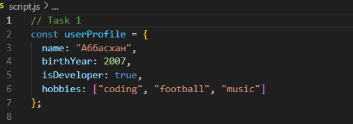
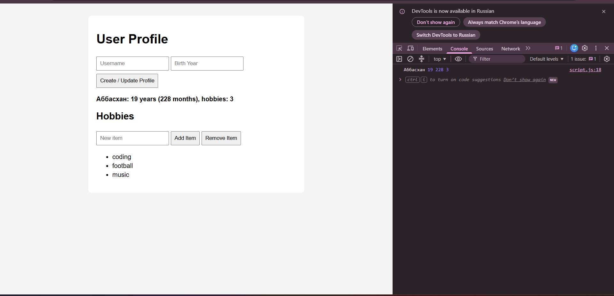

# Assignment #4: Forms and Validation

 Ibraimov Abbaskhan
IT-2502

---

## Overview
This project is a web application built with HTML5, Bootstrap 5, and JavaScript. It implements contact and registration forms using built-in HTML5 validation attributes and Bootstrap validation feedback styles.

---

## Assignment Tasks & Screenshots

### Part 1 & 2: Contact Form
Created a contact form with Name, Email, and Message fields, structured with proper label elements, Bootstrap form classes, and validation feedback.

### Part 3: Registration Form
Developed a registration form featuring first and last names using Bootstrap Grid layout, email, password confirmation checks, gender radio buttons, hobbies checkboxes, and a country selection dropdown.

## Summary of Work Process
1. Designed the user interface in index.html using semantic HTML tags and responsive Bootstrap grid components.
2. Applied native HTML5 validation constraints directly to input elements.
3. Created an external script in js/main.js to handle form submission events, check field validity, verify password matching, and activate Bootstrap validation feedback classes.