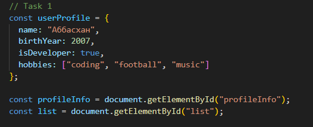
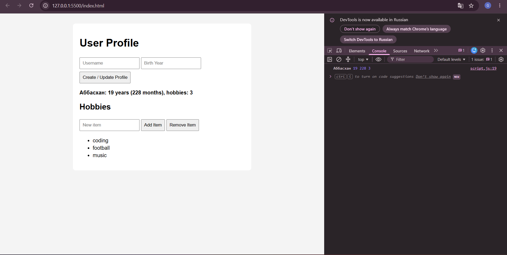
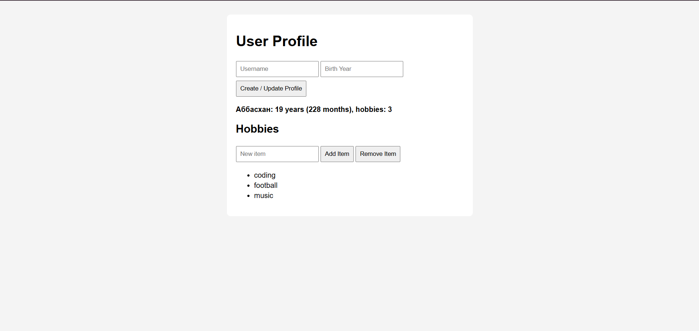

# Assignment 5. JavaScript Basics (DOM Manipulation & Events)

**Name:** Ibraimov Abbaskhan
**Group:** IT-2501

## Part 1: Profile Object, Data Types & Arithmetic

### Task 1. The Personal Info Object
userProfile const object with string, number, boolean and array.

### Task 2. Arithmetic Calculations
Age (current year - birthYear), age in months, hobbies count, shown on the page and in the console.

## Part 2: Form Input & Event Responses

### Task 3. HTML Form Setup
Form with Username, Birth Year and "Create / Update Profile" button.

### Task 4. Event Listener
Submit event captures input values and updates userProfile.

## Part 3: DOM List Manipulation

### Task 5. Creating & Removing Elements
<ul> list, "Add Item" adds a new <li>, "Remove Item" deletes the last one.

## Summary
In this assignment I practiced the basics of JavaScript and DOM manipulation. First, I created the userProfile object with a string, a number, a boolean and an array. Then I calculated the user’s age (current year minus birth year), the age in months and the hobbies count, and displayed them on the page and in the console.

Next, I built the input fields for username and birth year with a Create / Update Profile button. A click event listener reads the input values, updates the userProfile object and changes the text and color of the profile info.

Finally, I created a hobbies list (ul) with two buttons: Add Item adds a new li from the input field, and Remove Item deletes the last item. The hobbies counter updates after every change.

The main difficulties were connecting the local repository to GitHub and keeping the counter in sync with the list. I solved them by reading the number of li elements directly from the list. I tested the project in the browser and checked the console output to make sure it runs without errors.
