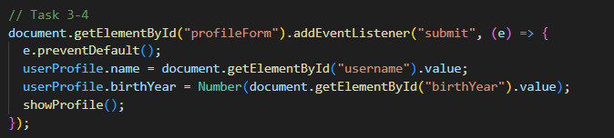
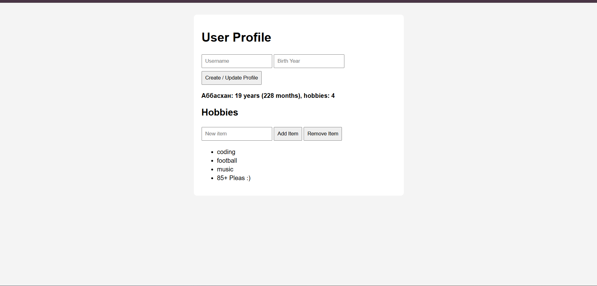

# Assignment 5. JavaScript Basics (DOM Manipulation & Events)

**Name:** Ibraimov Abbaskhan
**Group:** IT-2501

**GitHub Pages:** https://abbaskhan07.github.io/WEB2/

## Part 1: Profile Object, Data Types & Arithmetic

### Task 1. The Personal Info Object
userProfile const object with string, number, boolean and array.

### Task 2. Arithmetic Calculations
Age (current year - birthYear), age in months, hobbies count, shown on the page and in the console.

## Part 2: Form Input & Event Responses

### Task 3. HTML Form Setup
Form with Username, Birth Year and "Create / Update Profile" button.

### Task 4. Event Listener
Submit event captures input values and updates userProfile.

## Part 3: DOM List Manipulation

### Task 5. Creating & Removing Elements
<ul> list, "Add Item" adds a new <li>, "Remove Item" deletes the last one.

## Summary
Short description of the work process.